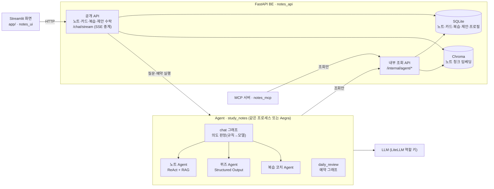

# 학습 노트 비서 (study-notes)

공부하며 쓴 노트를 **찾아 주고, 요약하고, 노트를 근거로 질문에 답하고, 퀴즈 카드로 만들어 복습 일정까지 챙겨 주는** 멀티 에이전트 서비스다. agent-template(Aegra 위 LangGraph 공통 틀)에서 시작했다.

- 개발 규칙: [AGENTS.md](AGENTS.md)
- 구조: [docs/01-구조.md](docs/01-구조.md)
- 개발 가이드(실행·기능 넣기): [docs/02-개발-가이드.md](docs/02-개발-가이드.md)
- MCP 서버: [docs/03-mcp.md](docs/03-mcp.md)
- 작업 계획·진행 기록(Unit of Work): [docs/study-notes-mvp/00-overview.md](docs/study-notes-mvp/00-overview.md)

## 1. 해결하는 문제

노트는 쌓이는데 다시 보지 않는다. 필요할 때 어디 적었는지 못 찾고, 외운 줄 알았던 개념을 잊는다.

| 사용자가 하는 말 | 담당 | 하는 일 |
|---|---|---|
| "체크포인터가 뭐야?" | 노트 Agent | 노트를 의미 검색(RAG)해 근거와 함께 답한다. 모델이 있으면 ReAct로 검색·노트 읽기를 스스로 고른다 |
| "StateGraph 기초 요약해줘" | 노트 Agent | 학습자 선호(길이)에 맞춰 핵심을 뽑는다 (Structured Output) |
| "그 노트로 퀴즈 내줘" | 퀴즈 Agent | 대화 메모리로 "그 노트"를 찾아, 근거가 확인된 문답 카드 초안을 만든다 → [카드 저장] |
| "오늘 뭐 복습해?" / "공부 현황 어때?" | 복습 코치 Agent | BE가 계산한 복습 대상·정답률·약한 노트로 안내·코칭한다 |
| "앞으로 요약은 짧게 해줘" | 복습 코치 Agent | 장기 메모리(학습자 프로필) 변경을 제안한다 → [기억하기] |

모델이 없어도(가짜 모델) 모든 기능이 **규칙 답**으로 돈다. 모델을 켜면 같은 경로가 Function Calling·ReAct·Structured Output으로 돈다.

## 2. 구조



핵심 원칙 (AGENTS.md)

- **일의 순서는 코드가 정한다.** 최상위는 LangGraph `StateGraph`, 모델은 판단이 필요한 곳(의도 분류, 요약, 질의 ReAct, 퀴즈, 코칭)에만.
- **Agent는 BE에 쓰지 않는다.** 카드 저장·선호 변경은 제안 초안 + 버튼으로 돌려주고, 사용자가 누르면 BE가 `dedupe_key`로 한 번만 반영한다.
- **숫자 계산은 BE가 한다.** 복습 간격(SM-2), 정답률, 연속 학습일, 약한 노트는 BE가 계산하고 Agent는 설명만 한다.
- **모델이 없어도 돈다.** 모델이 실패하면 규칙 답으로 바꾼다.

## 3. 과제 요구사항 대응

| 요소 | 구현 | 위치 |
|---|---|---|
| 프롬프트 엔지니어링 | 역할 지시·근거 제한·단계적 사고(`reasoning` 칸, 화면에 안 보임)·few-shot·JSON 스키마. 버전 파일 + 실행 기록에 버전 | `agents/*/prompts/*.v1.md`, `orchestrator/prompts/orchestrator.classify.v2.md` |
| 멀티 에이전트 | 오케스트레이터(규칙→모델 분류, 한 질문 최대 3의도) + 하위 Agent 3개. 하위 Agent끼리는 `ask` 버튼으로 잇는다 | `graphs/chat.py`, `agents/{notes,quiz,review}` |
| Tool Calling · ReAct | 게이트웨이 Function Calling(`tools`·`tool_calls`) + `BaseAgent.react()` 루프(허용 목록·호출 상한·단계 상한·기록) | `llm/gateway.py`, `agents/base.py` |
| Memory | 단기: 체크포인터 + `focus_note_ids`("그 노트"). 장기: 학습자 프로필(선호 + 약한 노트) | `graphs/chat.py`, `notes_api/store` |
| RAG | 전처리(소제목·문단·길이 분할, 겹침) → 임베딩(LiteLLM 또는 해시) → Chroma → 출처 포함 검색 | `notes_api/rag/` |
| Streamlit UI | 채팅(근거·실행 흔적·버튼), 노트, 복습(카드 넘기기), 설정 | `app/` |
| FastAPI BE | 공개 API + Agent 내부 조회 API + SSE 중계 + 예약 실행 | `notes_api/` |
| Structured Output · Function Calling (선택 A) | Pydantic JSON 스키마 출력 + 근거 검증, 도구 호출 | `ask_llm_json`, `react` |
| MCP (선택 B) | 노트 조회 도구 4개를 MCP 서버(stdio)로 | `notes_mcp/`, [docs/03-mcp.md](docs/03-mcp.md) |
| Docker (선택) | `Dockerfile`, `docker-compose.yml` — 이 PC에 Docker가 없어 **미검증** | 저장소 루트 |
| A2A (선택 C) | 범위 밖 | — |

## 4. 바로 돌려 보기 (모델·DB 없이)

```powershell
py -3.13 -m venv .venv
```

```powershell
.\.venv\Scripts\python.exe -m pip install -e ".[dev,api,ui,mcp,llm]"
```

```powershell
.\tools\run_dev.ps1
```

BE(`http://127.0.0.1:8000/docs`)와 화면(`http://localhost:8501`)이 새 창으로 뜬다. 처음 뜰 때 데모 노트 5개를 넣고 적재한다(`data/`, 저장소에 올리지 않음). 따로 띄우려면:

```powershell
.\.venv\Scripts\python.exe -m uvicorn notes_api.main:app --port 8000
```

```powershell
.\.venv\Scripts\python.exe -m streamlit run app/streamlit_app.py
```

### 데모 순서

1. 채팅에서 예시 "체크포인터가 뭐야?" → 근거 노트와 함께 답
2. "그 노트로 퀴즈 내줘" → 대화 메모리로 같은 노트 → [카드 3장 저장]
3. "앞으로 요약은 짧게 해줘" → [기억하기] → "StateGraph 기초 요약해줘"가 3줄로
4. 복습 화면 → [오늘 계획 만들기] → 카드 넘기기 → 등급 → 다음 복습일
5. 노트 화면에서 새 노트 저장 → 채팅에서 그 내용으로 질문

## 5. 실제 모델 켜기

`.env.example`을 `.env`로 복사하고 채운다(키는 `.env`에만).

```dotenv
STUDY_NOTES_LLM__MODE=litellm
STUDY_NOTES_LLM__MODELS={"router": "openai/gpt-4o-mini", "worker": "openai/gpt-4o-mini", "judge": "openai/gpt-4o-mini"}
OPENAI_API_KEY=...
# 임베딩도 바꾸려면 (바꾼 뒤 설정 화면에서 '전체 다시 적재')
NOTES_API_EMBEDDING_MODE=litellm
NOTES_API_EMBEDDING_MODEL=openai/text-embedding-3-small
```

## 6. Aegra로 돌리기

Agent를 BE 프로세스 대신 Aegra 서버(LangGraph Platform 대체, PostgreSQL 필요)에 올린다. 절차는 [docs/02 §3](docs/02-개발-가이드.md). 요약: `.env`에 `POSTGRES_*`, `STUDY_NOTES_BE__MODE=http` → `aegra serve` → `NOTES_API_AGENT_MODE=aegra`로 BE → `tools\smoke_aegra.py`.

## 7. 검사

| 하는 일 | 명령 |
|---|---|
| 시험 | `.\.venv\Scripts\python.exe -m pytest -q` |
| 린트 | `.\.venv\Scripts\python.exe -m ruff check src tests tools migrations app` |
| 형식 | `.\.venv\Scripts\python.exe -m ruff format --check src tests tools migrations app` |
| 타입 | `.\.venv\Scripts\python.exe -m mypy` |
| 평가 | `.\.venv\Scripts\python.exe -m study_notes.eval` |

## 8. 기술 스택

| 영역 | 선택 |
|---|---|
| 언어 | Python 3.12+ (개발 PC 3.13) |
| Agent | LangGraph 1.2, Aegra 0.12(선택) |
| 모델 호출 | LiteLLM, 역할 키(router·worker·judge·embedding) |
| BE | FastAPI, SQLite, Chroma |
| 화면 | Streamlit |
| MCP | 공식 Python SDK `mcp` 2.x |
| 검사 | pytest, ruff, mypy(strict) |

## 9. 정하지 않은 것

- 실제 LLM·임베딩 공급자와 키
- 다중 사용자·인증(지금은 로컬 1인용. BE 인증 없음, Aegra는 `dev` 헤더)
- 운영 배포(Docker 파일은 미검증), A2A
