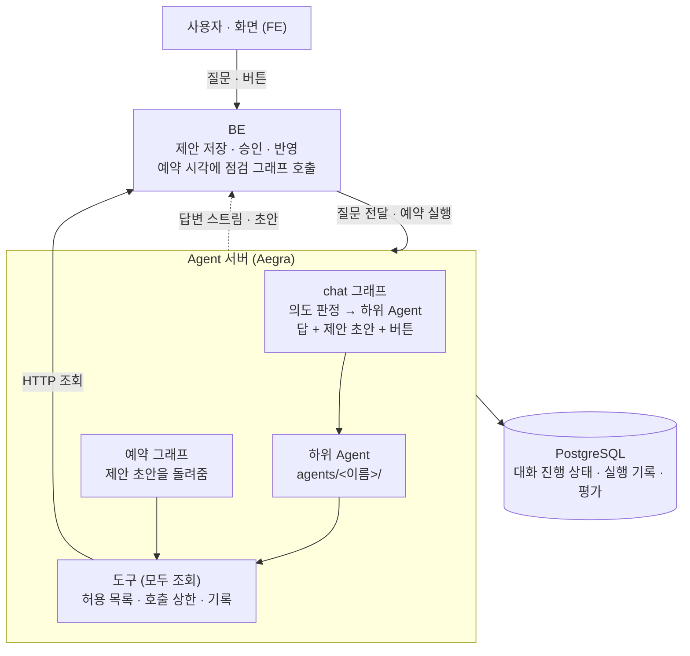

# agent-template — Agent 서비스 공통 틀

채팅 Agent 서비스를 새로 만들 때 복사해서 쓰는 코드베이스다. BMS ai-agent(2026-11-23)에서 업무 내용을 빼고 공통 부분만 남겼다.

- 개발 규칙: [AGENTS.md](AGENTS.md)
- 구조: [docs/01-구조.md](docs/01-구조.md)
- 개발 가이드(새 프로젝트 시작, 기능 넣기): [docs/02-개발-가이드.md](docs/02-개발-가이드.md)

## 1. 무엇이 들어 있나

| 들어 있는 것 | 하는 일 |
|---|---|
| chat 그래프 | 질문 → 의도 판정(규칙 먼저, 안 되면 모델) → 담당 하위 Agent → 답을 SSE로 흘려보냄 |
| 하위 Agent 약속 (`BaseAgent`) | 도구 부르기, 모델 부르기, 모델 실패 시 규칙 답, 버튼·근거·제안 초안 만들기 |
| 예약 그래프 틀 | BE가 부르면 조회만 해서 제안 초안을 돌려줌 |
| 도구 실행기 | Agent별 허용 도구, 실행당 호출 상한, 호출 기록 |
| BE 클라이언트 | 조회만 있는 약속(`BeClient`), HTTP 구현, 가짜 BE |
| 모델 게이트웨이 | 역할 키(router·worker·judge), 타임아웃, 분당 상한, 캐시, 가짜 모델 |
| 실행 기록·DB | JSON 로그, PostgreSQL 기록(ORM + Alembic), Aegra 테이블은 건드리지 않음 |
| 평가 | 질문·기대 의도·들어갈 말을 yaml로 적고 `python -m study_notes.eval` |
| 시험 | 단위·그래프·평가 시험, "BE에 쓰는 코드가 생기면 실패"하는 시험 |
| 예시 Agent 1개 | `agents/tasks` (할 일 목록·설명). 새 프로젝트는 이것을 지우고 자기 Agent를 넣는다 |

## 2. 핵심 원칙

- **일의 순서는 코드가 정한다.** 처리 순서는 LangGraph 그래프로 짜고, 모델은 판단이 필요한 단계에만 쓴다.
- **ai-agent는 BE에 쓰지 않는다.** 바꿀 일은 제안 초안과 버튼으로 돌려주고, 저장·승인·반영은 BE가 한다.
- **숫자 계산은 BE가 한다.** Agent는 받은 숫자를 설명한다.
- **모델이 없어도 돈다.** 모델이 실패하면 규칙 답으로 바꾼다. 가짜 BE·가짜 모델로 끝까지 개발·시험할 수 있다.
- **새 기능은 자기 Agent 폴더만 고친다.** 의도·도구·규칙·프롬프트를 Agent 폴더에 두고, 목록에 한 줄 추가한다.



## 3. 바로 돌려 보기

```powershell
python -m venv .venv
.\.venv\Scripts\python.exe -m pip install -e ".[dev,postgres]"
.\.venv\Scripts\python.exe -m pytest -q
.\.venv\Scripts\python.exe -m study_notes.eval
```

가짜 BE·가짜 모델이 기본이라 BE·LLM·DB 없이 돈다. Aegra로 띄우는 방법은 개발 가이드 §3.

## 4. 새 프로젝트 만들기

```powershell
.\.venv\Scripts\python.exe tools\new_project.py D:\workspace\<프로젝트>\ai-agent <패키지_이름>
```

폴더를 복사하고 패키지 이름·환경 변수 접두어를 바꾼다. 그다음 할 일은 개발 가이드 §6.

## 5. 기술 스택

| 영역 | 선택 |
|---|---|
| 언어 | Python 3.12+ |
| 에이전트 프레임워크 | LangGraph 1.2.x |
| 에이전트 서버 | [Aegra](https://github.com/ibbybuilds/aegra) 0.12 (LangGraph Platform을 대신하는 자체 설치형 서버) |
| 모델 호출 | LiteLLM (선택). 모델은 역할 키로만 부른다 |
| DB | PostgreSQL. 우리 테이블은 SQLAlchemy ORM + Alembic |
| 데이터 모델 | Pydantic v2, pydantic-settings |
| 검사 | ruff, mypy(strict), pytest |

## 6. 프로젝트마다 정해야 하는 것

틀은 아래를 정하지 않고 설정이나 약속 뒤에 숨겨 두었다. 자세한 위치는 [docs/01 §10](docs/01-구조.md).

- BE 도구 API 경로·형식 (`tools/be_client/`)
- 사용자 토큰을 ai-agent에 넘기는 방식 (`server/auth.py`) — **지금 방식은 토큰이 Aegra DB에 남는다**
- LLM 경로·모델 (`.env`의 역할 키)
- 제안 초안을 BE가 저장하는 API와 버튼(`save_proposal`, `backend`)의 처리
- DB 접속·스키마 이름 (`.env`)
