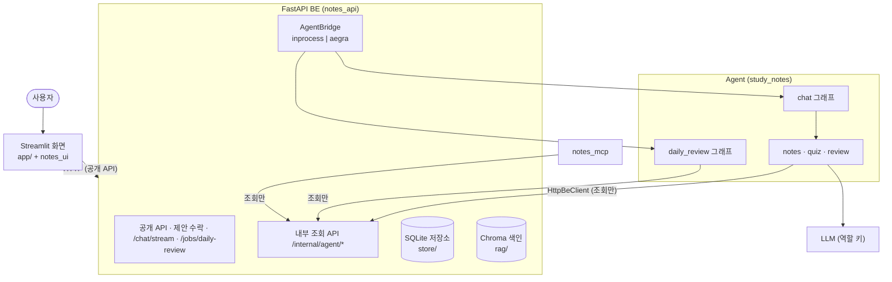
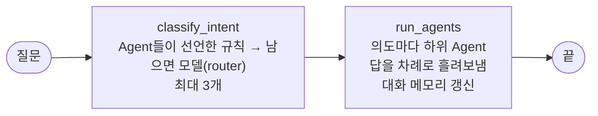

# 01. 구조

- 범위: 화면(`app/`, `src/notes_ui`), BE(`src/notes_api`), Agent(`src/study_notes`), MCP 서버(`src/notes_mcp`).
- 이 문서의 폴더·이름은 실제 코드와 같다. 코드가 바뀌면 이 문서를 같이 고친다.

---

## 1. 한 장 요약



- 화면은 BE만 부른다. Agent에 직접 붙지 않는다.
- Agent는 BE 내부 조회 API만 부른다(`HttpBeClient`). **쓰지 않는다.** 바꿀 일은 제안 초안 + 버튼으로 돌려준다.
- BE는 저장·숫자 계산(복습 간격·통계·약한 노트)·RAG 적재·Agent 호출 중계를 한다.
- `inprocess` 모드면 BE 프로세스 안에서 그래프를 돌리고 Agent의 HTTP 조회는 ASGI로 같은 앱에 간다(네트워크·PostgreSQL 불필요). `aegra` 모드면 Aegra 서버를 langgraph-sdk로 부른다.

## 2. 진입점 (aegra.json)

| 그래프 ID | 파일 | 누가 부르나 | 하는 일 |
|---|---|---|---|
| `chat` | `graphs/chat.py` | BE `/chat/stream` | 의도 판정 → 하위 Agent → 답·근거·제안 초안·버튼 (SSE custom 이벤트) |
| `daily_review` | `graphs/daily_review.py` | BE `/jobs/daily-review` | 노트북마다 오늘 복습 계획 제안 초안. BE가 저장 |

## 3. chat 그래프



```python
class ChatState(TypedDict, total=False):
    messages: Annotated[list[AnyMessage], add_messages]  # 대화
    intents: list[str]
    replies: list[dict]          # 이번 질문의 답(요약). 제안 초안도 여기
    focus_note_ids: list[str]    # 단기 메모리: 최근 다룬 노트(최신 먼저, 최대 3)
```

- 입력 context(`AgentContext`): `subject_id` = 노트북 ID(`NB-1`), `screen` = `{"note_id": 보고 있는 노트, "base_date": 기준일}`
- thread_id 형식 `chat:{사용자ID}:{uuid}` (inprocess). Aegra 모드는 Aegra가 만든 ID.

## 4. 하위 Agent

| Agent | 의도 | 도구 (모두 조회) | 모델 | 규칙 답 |
|---|---|---|---|---|
| notes (노트) | `note_summary` 요약 | `notes_list_items`, `notes_get_item`, `notes_get_profile` | `ask_llm_json(SummaryOut)` | 소제목 첫 문장 + `- 용어: 설명` 줄 |
| | `note_search` 찾기 | `notes_list_items`, `notes_search_chunks` | — | 키워드 + 의미 검색 합침 |
| | `note_qa` 노트 기반 질의 | `notes_search_chunks`★, `notes_get_item`★ | `react()` (★ = 모델이 고름) | 상위 검색 조각 발췌 |
| quiz (퀴즈) | `quiz_make` | `quiz_list_notes`, `quiz_get_note`, `quiz_list_cards`, `quiz_get_profile` | `ask_llm_json(QuizOut)` + 근거 검증 | `- 용어: 설명` 줄 → 카드 |
| review (복습 코치) | `review_stats` 현황 | `review_get_stats`, `review_get_profile` | `ask_llm`(코칭) | 숫자 나열 + 약한 노트 |
| | `review_today` 오늘 복습 | `review_list_due` | — | 항상 |
| | `profile_update` 선호 기억 | — | — | 선호 파싱 → 제안 |

- 노트 고르기(`agents/note_ref.py`): ① 질문의 노트 제목 ② "이 노트" + 화면 노트 ③ "그 노트" + 대화 메모리 ④ 화면 노트 ⑤ 대화 메모리 ⑥ 검색 1위.
- 하위 Agent끼리 부르지 않는다. 이어지는 일은 `ask` 버튼("이 노트로 퀴즈")으로 사용자가 잇는다.

### 4.1 ReAct (`BaseAgent.react`)

```text
모델(도구 정의 포함) → tool_calls? ─ 예 → 허용 목록 확인 → self.tool() 실행(상한·기록) → 관찰을 tool 메시지로 → 다시 모델
                                └ 아니오 → 최종 답 (단계 상한 넘으면 LlmUnavailableError → 규칙 답)
```

- 입력 오류(`ToolInputError`)는 관찰로 돌려줘 모델이 고친다. 권한·상한 오류는 즉시 멈춘다.
- 실행 흔적(`data.trace`: 단계·도구·인자·관찰 앞부분)을 화면이 "Agent 실행 흔적"으로 보여 준다.

### 4.2 메모리

| 종류 | 어디 | 쓰는 곳 |
|---|---|---|
| 단기 | 체크포인터(thread) + `focus_note_ids` | "그 노트로 퀴즈", "그 노트 핵심만 다시" |
| 장기 | BE 학습자 프로필: `summary_length`, `quiz_difficulty`(사용자 선호), `weak_notes`(BE 계산) | 요약 길이, 퀴즈 난이도, 코칭 |

장기 메모리 변경은 Agent가 `profile.update` 제안 → 사용자 [기억하기] → BE 반영.

## 5. 이벤트와 버튼 (`core/reply.py`)

SSE `data: {json}` 줄. 모든 이벤트에 `schema_version`(1). BE가 끝에 `{"type":"done"}`, 실패 시 `{"type":"error","text"}`.

| `type` | 내용 |
|---|---|
| `orchestrator` | `agents`(담당 Agent 이름), `text` |
| `agent_reply` | `reply`: `agent`, `text`, `source`(`ai`/`rule`), `actions`, `citations`, `proposals`, `data`(`trace`, `cards`, `notes`, `stats`, `key_points`, `focus_note_ids`), `prompt_version` |

| 버튼 `kind` | 누르면 (화면 `notes_ui/actions.py`) |
|---|---|
| `ask` | `text`를 다음 질문으로 보냄 |
| `save_proposal` | 그 답의 `proposals[params.index]`를 BE `POST /proposals/accept` |
| `navigate` | `target` 화면(`review`, `notes`)으로 이동 |

## 6. 제안 초안 (`core/proposal.py`)

| `kind` | 누가 | payload | BE 반영 |
|---|---|---|---|
| `quiz.cards_add` | quiz | `note_id`, `cards[{question, answer}]` | 카드 추가(같은 질문 건너뜀) |
| `profile.update` | review | `summary_length?`, `quiz_difficulty?` | 프로필 선호 변경 |
| `review.daily_plan` | daily_review | `base_date`, `card_ids` | 저장(복습 화면이 계획으로 씀) |

`dedupe_key`: 대화 제안은 thread·Agent·내용 해시, 예약 제안은 `daily_review`·노트북·기준일. BE는 이 키에 유니크 제약을 걸어 한 번만 저장한다.

## 7. BE API (`notes_api`)

### 7.1 공개 API (화면용)

| 메서드 | 경로 | 하는 일 |
|---|---|---|
| GET | `/health` | 노트·청크 수, Agent 모드 |
| GET·POST | `/notebooks` | 노트북 목록·만들기 |
| GET·POST | `/notebooks/{nb}/notes` | 노트 목록(키워드)·만들기(저장 시 적재) |
| GET·PUT·DELETE | `/notes/{id}` | 노트 보기·고치기(다시 적재)·지우기 |
| GET | `/notebooks/{nb}/cards`, `/notebooks/{nb}/due` | 카드, 복습할 카드 |
| POST | `/cards/{id}/review` | 등급(again/hard/good/easy) → 다음 복습일 계산 |
| GET | `/notebooks/{nb}/stats` | 학습 통계 |
| GET·PUT | `/profile` | 학습자 프로필 |
| POST | `/proposals/accept` | 제안 저장·반영(한 번만) |
| GET | `/proposals`, `/notebooks/{nb}/daily-plan` | 제안 목록, 오늘 계획 + 카드 |
| POST | `/chat/threads`, `/chat/stream` | 대화 시작, SSE 중계 |
| POST | `/jobs/daily-review` | 예약 그래프 실행 → 제안 저장 |
| POST | `/admin/reindex` | 전체 다시 적재 |

### 7.2 내부 조회 API (`/internal/agent`, Agent·MCP용 — 조회만)

| 메서드 | 경로 | `BeClient` |
|---|---|---|
| GET | `/notebooks` | `list_subjects` |
| GET | `/notebooks/{nb}/notes?query=&limit=` | `list_notes` |
| GET | `/notes/{id}` | `get_note` |
| POST | `/notebooks/{nb}/search` `{"query","k"}` | `search_chunks` (상태를 바꾸지 않는 검색) |
| GET | `/notebooks/{nb}/cards?note_id=` | `list_cards` |
| GET | `/notebooks/{nb}/due?base_date=&limit=` | `list_due_cards` |
| GET | `/notebooks/{nb}/stats?base_date=` | `get_review_stats` |
| GET | `/profile?base_date=` | `get_learner_profile` |

오류는 RFC 9457(`{"type","title","status","detail"}`). 404·400 → Agent 쪽 `ToolInputError(hint=detail)`. 시험이 내부 API에 쓰기 메서드가 없는지 확인한다.

## 8. RAG (`notes_api/rag`)

```text
노트 저장 → split_note(소제목 → 문단 → 400자 창, 50자 겹침, "제목 > 소제목" 머리) → Embedder → Chroma(note_chunks, cosine)
검색: 질의 임베딩 → notebook_id 필터 → top-k → score = 1 - 거리 → ChunkHit(note_id, title, heading, text, score)
```

- 적재는 노트 저장 때 BE가 한다(대화 중 적재 금지). 청크 메타데이터에 `embedder`·`embedder_version`.
- `Embedder`: `HashEmbedder`(문자 2·3-gram 해시, 모델 없이) | `LiteLlmEmbedder`(설정 `NOTES_API_EMBEDDING_*`).

## 9. 저장소와 계산 (`notes_api/store`)

| 테이블 | 내용 |
|---|---|
| `notebooks`, `notes` | 노트북·노트 |
| `cards` | 문답 카드 + SM-2 상태(ease, interval_days, repetitions, lapses, due_date). `dedupe_key`=노트+질문 |
| `reviews` | 복습 기록(grade, reviewed_on) |
| `proposals` | 수락한 제안(`dedupe_key` 유니크, status saved/applied) |
| `profile` | 선호(1행) |

복습 간격(`srs.py`): again → 1일·ease−0.2 / hard → ×1.2·ease−0.15 / good → 1→3→×ease / easy → good×1.3·ease+0.15, ease 하한 1.3.

## 10. 폴더

```text
study-notes/
├─ app/                         # Streamlit: streamlit_app.py, common.py, views/{chat,notes,review,settings}.py
├─ src/
│  ├─ notes_api/                # BE: main.py, config.py, bridge.py, routes/, store/, rag/
│  ├─ notes_ui/                 # 화면 로직: api.py(BE 클라이언트), sse.py, actions.py, view.py
│  ├─ notes_mcp/                # MCP 서버
│  └─ study_notes/              # Agent
│     ├─ graphs/                # chat, daily_review, scheduled(공통)
│     ├─ agents/                # base.py(react 포함), registry.py, note_ref.py, notes/, quiz/, review/
│     ├─ orchestrator/          # 의도 분류(규칙 → 모델, 프롬프트 v2)
│     ├─ llm/                   # 게이트웨이(Function Calling), 가짜 모델, LiteLLM
│     ├─ tools/                 # 도구 등록·실행기, BeClient(HTTP·가짜)
│     └─ eval/                  # 평가 실행기·질문(yaml)
├─ tests/                       # unit · graph · api · contract · ui · mcp
├─ tools/                       # run_dev.ps1, smoke_aegra.py
└─ docs/                        # 01 구조 · 02 개발 가이드 · 03 MCP · study-notes-mvp(UoW)
```

## 11. 정하지 않은 것

| 정할 것 | 숨긴 곳 |
|---|---|
| LLM·임베딩 공급자 | `.env`의 `STUDY_NOTES_LLM__MODELS`, `NOTES_API_EMBEDDING_*` |
| 다중 사용자·인증 | BE는 인증 없음(로컬), Agent는 `server/auth.py`(`dev` 헤더). **Aegra 0.12는 auth가 돌려준 토큰을 `runs.execution_params`에 저장한다** — 토큰을 쓰게 되면 바꿔야 한다 |
| 배포 | `Dockerfile`, `docker-compose.yml` (미검증) |
