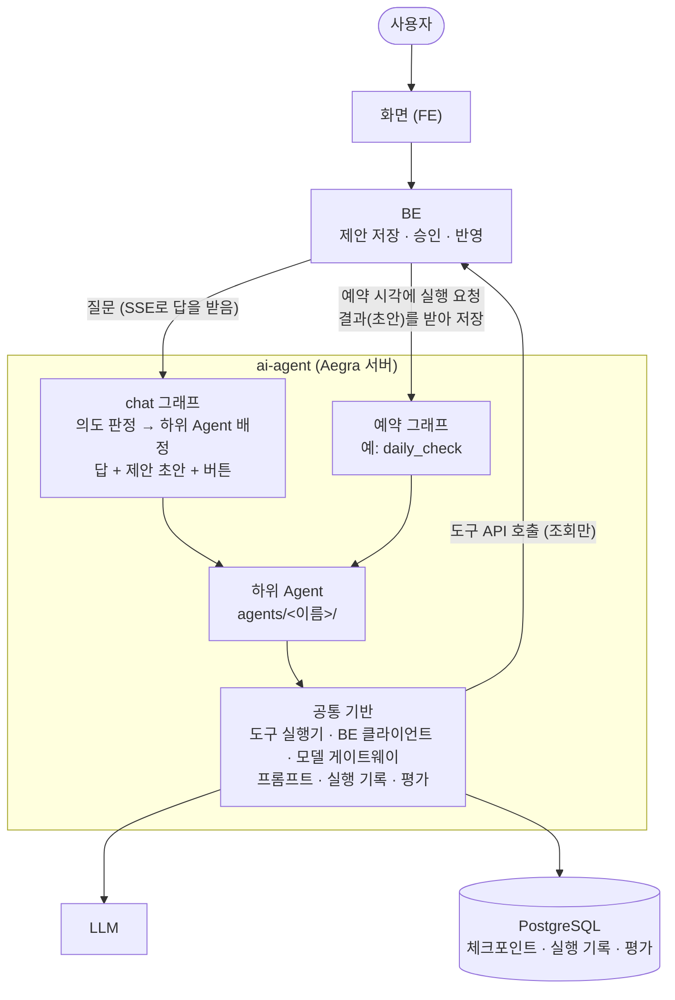
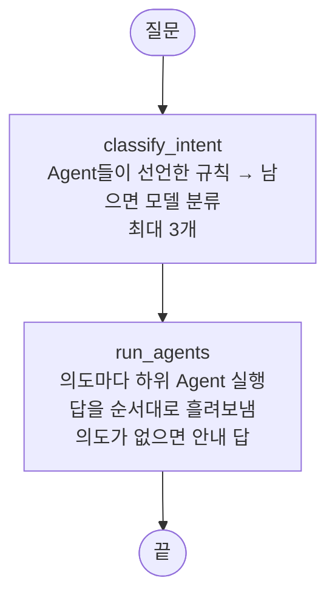
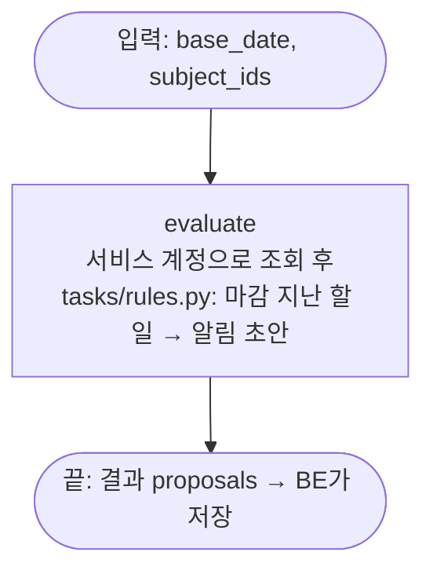

# 01. 구조

- 범위: ai-agent 서비스 안. FE·BE 내부는 다루지 않고, ai-agent가 BE와 주고받는 약속만 적는다.
- 이 문서의 폴더·이름은 실제 코드(`src/study_notes/`)와 같다. 코드가 바뀌면 이 문서를 같이 고친다.

---

## 1. 한 장 요약



- 사용자는 ai-agent에 직접 붙지 않는다. FE → BE → ai-agent.
- ai-agent는 업무 데이터를 직접 읽지 않고 BE 도구 API만 부른다.
- **ai-agent는 BE에 쓰지 않는다.** 바꿀 일은 제안 초안으로 돌려주고, 저장·승인·반영은 BE가 한다 (§5).
- **Agent 개발자는 `agents/<자기 Agent>/` 폴더만 고친다.** 나머지(그래프, 의도 판정, 도구 실행기, 모델 호출, 기록)는 공통 기반이 해 준다.

## 2. 진입점 (Aegra에 등록하는 그래프)

| 그래프 ID | 파일 | 누가 부르나 | 하는 일 |
|---|---|---|---|
| `chat` | `graphs/chat.py` | BE (사용자 질문) | 의도 판정 → 하위 Agent → 답·제안 초안·버튼을 돌려줌 |
| `daily_check` (예시) | `graphs/daily_check.py` | BE (예약 시각에) | 마감 지난 할 일을 찾아 알림 제안 초안을 돌려줌. BE가 받아 저장 |

등록 파일은 `aegra.json`이다. 예약 그래프는 **BE가 부르고 결과를 받아 저장한다.** 결과를 받을 쪽이 BE여야 하므로 Aegra cron은 쓰지 않는다.

## 3. chat 그래프

### 3.1 흐름



| 노드 | 하는 일 |
|---|---|
| `classify_intent` | 하위 Agent들이 `intents`로 선언한 규칙(정규식)을 등록 순서대로 건다. 걸리는 것이 없으면 모델(역할 키 `router`)이 설명(`help`)을 보고 고른다 (`orchestrator/`) |
| `run_agents` | 의도마다 담당 하위 Agent의 `run()`을 순서대로 부른다. 담당 안내와 답을 SSE로 흘려보낸다. 의도가 하나도 없으면 "이런 것을 물어볼 수 있습니다" 안내를 답한다 |

멈춤(`interrupt`)·승인·실행 노드는 없다.

### 3.2 State

```python
class ChatState(TypedDict, total=False):
    messages: Annotated[list[AnyMessage], add_messages]   # 대화
    intents: list[str]          # classify_intent 결과
    replies: list[dict]         # 이번 질문의 하위 Agent 답(요약). 제안 초안도 여기
```

- State에는 요약과 ID만 둔다. BE 응답 원문, 토큰은 넣지 않는다.
- 대화 이력은 Aegra가 `thread`로 보관한다. 여러 화면의 대화를 잇고 싶으면 BE가 같은 `thread_id`로 부른다.

### 3.3 BE ↔ ai-agent 약속

Aegra는 LangGraph SDK와 같은 API를 쓴다. BE는 아래만 쓰면 된다.

| 하는 일 | 호출 | 비고 |
|---|---|---|
| 대화 시작 | `POST /threads` (metadata에 사용자·대상) | thread_id 형식 `chat:{사용자ID}:{uuid}` |
| 질문 보내고 답 받기 | `POST /threads/{thread_id}/runs/stream`<br/>`assistant_id="chat"`, `stream_mode=["custom","values"]`<br/>`input={"messages":[{"role":"user","content":"..."}]}`<br/>`context={"subject_id":..., "screen":{...}}` | SSE |
| 끊긴 답 다시 받기 | `GET /threads/{thread_id}/runs/{run_id}/stream` + `Last-Event-ID` | Aegra 문서 기준 |
| 예약 실행 | thread를 만들고 실행해 끝난 결과를 받는다. 예: `assistant_id="daily_check"`, `input={"base_date": "YYYY-MM-DD"}` | 결과의 `proposals`를 BE가 저장. 어느 API(`runs.wait` 등)로 받을지는 Aegra에서 확인 안 함 |
| 누가 묻는지 알리기 | 헤더 `X-User-Id`, `X-User-Role`, `X-User-Name`(URL 인코딩). `trusted_be` 모드면 `X-Agent-Key`도 | `server/auth.py`. 이름은 프로젝트에서 BE와 맞춘다 |

동작하는 예: `tools/smoke_aegra.py`.

**`custom` 스트림 이벤트** — 화면이 그대로 그릴 수 있게 ai-agent가 내보내는 것. 정의는 `core/reply.py`. 모든 이벤트에 `schema_version`(지금 1)이 붙는다.

| `type` | 언제 | 내용 |
|---|---|---|
| `orchestrator` | 의도 판정 직후 | 담당 Agent 목록, 안내 문장 |
| `agent_reply` | 하위 Agent가 답했을 때 | `agent`, `text`, `source`(`ai`/`rule`), `actions`(버튼), `citations`(근거), `proposals`(제안 초안), `data`(표·숫자) |

`actions`는 화면 버튼이다. 누르면 FE가 처리하거나 BE를 부른다. ai-agent는 버튼 뒤의 일을 하지 않는다.

| `kind` | 누르면 | `params` |
|---|---|---|
| `navigate` | FE가 화면 이동 | `target`, 화면 인자 |
| `ask` | FE가 `text`를 다음 질문으로 보냄 | — |
| `save_proposal` | **BE가** 이 답의 `proposals[index]`를 저장 | `index` |
| `backend` | **BE가** `action`으로 정한 일을 처리 | `action`, 그 밖의 인자 |

`proposals`의 한 건(`ProposalDraft`, `core/proposal.py`): `kind`, `subject_id`, `title`, `payload`, `reasons`, `source`(`agent`/`chat`), `source_ref`, `dedupe_key`.

## 4. 하위 Agent 약속

모든 하위 Agent는 `agents/base.py`의 `BaseAgent`를 상속한다.

```python
class TasksAgent(BaseAgent):
    name = "tasks"                       # 폴더 이름과 같다
    title = "할 일 Agent"
    intents = (TASK_EXPLAIN, TASK_LIST)  # IntentSpec(이름, 설명, 규칙 정규식)

    async def run(self, req: AgentRequest) -> AgentResult: ...
```

| 넣는 것 (`AgentRequest`) | 돌려주는 것 (`AgentResult`) |
|---|---|
| `intent`, `text`(질문), `history`(최근 대화 요약). 사용자·대상·화면·thread는 `self.request`에 | `reply`(답: 글·출처·버튼·제안 초안·데이터) |

- 하위 Agent는 **요약된 결과만** 돌려준다.
- 하위 Agent끼리 서로 부르지 않는다. 다른 Agent의 일이 필요하면 `ask` 버튼을 붙여 사용자가 이어 묻게 한다.
- 등록: `agents/registry.py`의 `AGENTS`에 한 줄 추가. 그러면 오케스트레이터가 의도로 찾아 부른다.

`BaseAgent`가 주는 것:

| 메서드 | 하는 일 |
|---|---|
| `self.subject_id()` | 질문이 가리키는 대상 ID. 없으면 "무엇에 대한 질문인지" 안내 오류 |
| `await self.tool("tasks_list_items", args)` | 도구 실행기를 거쳐 도구를 부른다(모두 조회). 허용 목록·호출 상한·기록·오류 변환이 자동 |
| `self.prompt("explain")` | `agents/<name>/prompts/`에서 최신 버전 프롬프트를 읽는다 |
| `await self.ask_llm(...)` / `await self.ask_llm_json(Model, ...)` | 모델 게이트웨이로 부른다. 실패하면 `LlmUnavailableError` → 규칙 답으로 바꾼다 |
| `self.reply(..., actions=, citations=, proposals=)` | `AgentReply`를 만든다 |
| `self.proposal(kind=, title=, payload=, reasons=)` | 제안 초안(`ProposalDraft`)을 만든다. 대상 ID와 중복 방지 키가 자동으로 붙는다. 저장은 하지 않는다 |

## 5. 누가 쓰나 — ai-agent는 제안만, BE가 승인·저장

| 일 | ai-agent | BE |
|---|---|---|
| 조회 | 도구로 부른다 | 도구 API를 준다 |
| 계산 (합계, 한도 대조, 시뮬레이션) | 결과를 받아 설명 | 계산한다 |
| 제안 초안 만들기 (대화·예약) | 만든다 (`ProposalDraft`) | — |
| 초안 저장 | **안 한다** | 저장 (`dedupe_key`로 한 번만) |
| 사용자 확인·승인·반영 | **안 한다** | 버튼을 받아 처리 |
| 승인 감사 기록 | **안 한다** | 남긴다 |
| 자동 반영 | 만들지 않는다 | — |

- 지키는 방법: BE 클라이언트 약속(`BeClient`)에 쓰기 메서드가 없다. 시험(`tests/unit/test_platform.py`의 `test_be_client_has_no_write_methods`, `test_no_tool_writes_to_be`)이 쓰기로 보이는 이름이 생기면 실패한다.
- **중복 방지 키(`dedupe_key`)**: 초안마다 붙는다. 같은 키면 BE가 한 번만 저장해야 한다.
  - 대화 초안: thread + Agent + 내용 해시 (같은 대화에서 같은 요청을 두 번 해도 같은 키)
  - 예약 초안: 계기(예: 대상·할 일·기준일)

## 6. 예약 그래프

예시 `daily_check`:



- 판정은 `agents/<이름>/rules.py`에 함수로 둔다. 모델 없이 시험할 수 있게.
- 사람이 없으므로 읽기 전용 서비스 계정(`graphs/scheduled.py`의 `service_request`, `service_runner`)으로 조회한다.

## 7. 공통 기반

| 폴더 | 하는 일 | 개발자가 하는 것 |
|---|---|---|
| `config.py` | 모든 설정 (`STUDY_NOTES_` 접두어 환경 변수, DB는 `POSTGRES_*`) | 새 설정이 필요하면 여기에 추가 |
| `core/` | 요청 정보(`RequestInfo`), 답 형식(`AgentReply`), 제안 초안(`ProposalDraft`), ID·중복 방지 키, 오류 | 읽기만 |
| `server/auth.py` | Aegra 인증. BE가 보낸 사용자 정보를 확인 | BE와 정해 고침 |
| `orchestrator/` | 의도 규칙 분류기, 모델 분류 | 읽기만 (의도는 Agent 폴더에서 선언) |
| `tools/registry.py` | `@agent_tool` 데코레이터. 이름 규칙·인자 모델·독스트링 확인 | 도구에 붙인다 |
| `tools/guards.py` | 도구 실행기: 허용 목록, 호출 상한, 기록, 오류 → 고칠 방법이 담긴 문장 | 읽기만 |
| `tools/be_client/` | BE 클라이언트 약속(`BeClient`, 조회만)과 HTTP 구현 | 업무 조회 메서드 추가 |
| `tools/fakes/` | 가짜 BE와 합성 데이터 | 시험 데이터 추가 |
| `llm/` | 모델 게이트웨이: 역할 키, 타임아웃, 길이 상한, 분당 상한, 같은 요청 캐시, 가짜 모델 | 읽기만 |
| `prompts/loader.py` | 버전 붙은 프롬프트 파일 읽기 | 자기 `prompts/`에 파일 추가 |
| `observability/` | JSON 로그(공통 필드 `run_id`, `thread_id`, `graph`, `node`), 실행 기록 | 읽기만 |
| `db/` | 우리 테이블: ORM 모델, 세션, `python -m study_notes.db check` / `migrate` / `sql` | 테이블이 필요하면 모델 추가 + 리비전 (docs/02 §4.7) |
| `eval/` | 평가 질문 실행기 | 자기 평가 질문 추가 |
| `deps.py` | 의존성 모음(BE 클라이언트·모델·기록기). 시험 때 바꿔 끼운다 | 읽기만 |

### 7.1 모델 게이트웨이

- 역할 키: `router`(의도 분류), `worker`(답·해설 작성), `judge`(평가 채점). 실제 모델은 설정 `STUDY_NOTES_LLM__MODELS`로 연결한다.
- `STUDY_NOTES_LLM__MODE=fake`이면 가짜 모델(등록한 답만 하고 나머지는 실패), `litellm`이면 LiteLLM으로 부른다.
- 안전장치: 타임아웃, 응답 길이 상한, 분당 호출 상한, 같은 요청 캐시(TTL 있음).
- 실패하면 `LlmUnavailableError`를 던지고, 하위 Agent가 규칙 답(`source="rule"`)으로 바꾼다.

### 7.2 실행 기록

- 한 실행 = 하나의 `run_id`. 로그와 실행 기록에 같은 값이 남는다.
- 기본은 JSON 로그만 남기는 기록기(`LogRecorder`). PostgreSQL에 남기려면 `STUDY_NOTES_RECORDER=postgres`로 두고 `python -m study_notes.db migrate`로 테이블을 만든다.
- 도구 인자는 원문 대신 해시를 남긴다.

### 7.3 평가

- 평가 질문은 `src/study_notes/eval/cases/*.yaml`. 질문, 기대 의도, 답에 반드시 들어갈 말을 적는다.
- `python -m study_notes.eval`로 chat 그래프를 돌려 통과·실패를 출력한다.

## 8. 데이터

| 데이터 | 어디에 | 누가 관리 |
|---|---|---|
| 대화·체크포인트·thread·run | PostgreSQL (Aegra 테이블) | Aegra. 우리는 건드리지 않음 |
| 실행 기록·모델 호출·도구 호출·평가 결과 | PostgreSQL `AGENT_DB_SCHEMA` 스키마 (기본 `agent`) | 우리. ORM 모델 `db/models.py`, DDL은 Alembic `migrations/` |
| 업무 데이터·제안·승인 감사 기록 | BE | BE. 우리는 도구 API로 조회만 |

## 9. 폴더

```text
agent-template/
├─ aegra.json                 # 그래프 등록
├─ pyproject.toml
├─ .env.example
├─ alembic.ini, migrations/   # 우리 테이블 (Alembic)
├─ docs/                      # 이 문서들
├─ tools/                     # smoke_aegra.py(BE처럼 붙어 보기), new_project.py(새 프로젝트 만들기)
├─ src/study_notes/
│  ├─ config.py, deps.py
│  ├─ core/                   # 공통 타입
│  ├─ server/auth.py          # Aegra 인증
│  ├─ orchestrator/           # 의도 분류기
│  ├─ graphs/                 # chat · scheduled(공통) · daily_check(예시)
│  ├─ agents/
│  │  ├─ base.py, registry.py # 하위 Agent 약속·목록
│  │  └─ tasks/               # 예시 Agent (새 프로젝트에서 지운다)
│  ├─ tools/                  # 도구 실행기·BE 클라이언트·가짜 BE
│  ├─ llm/                    # 모델 게이트웨이
│  ├─ prompts/loader.py
│  ├─ observability/, db/     # 기록
│  └─ eval/                   # 평가 실행기·질문
└─ tests/
   ├─ unit/                   # 도구·규칙·안전장치·쓰기 금지·DB 설정
   └─ graph/                  # 경로·규칙 답·모델 답·초안·평가
```

각 하위 Agent 폴더의 모양은 같다.

```text
agents/<name>/
├─ __init__.py     # tools를 import해 도구를 등록
├─ agent.py        # BaseAgent 상속, intents, run()
├─ tools.py        # @agent_tool 업무 도구 (조회)
├─ rules.py        # 규칙·계산 (모델 없이 시험 가능)
└─ prompts/        # <name>.<용도>.v<n>.md
```

## 10. 프로젝트마다 정할 것

틀은 아래를 정하지 않고 숨겨 두었다.

| 정할 것 | 숨긴 곳 |
|---|---|
| BE 도구 API 경로·형식 | `tools/be_client/protocol.py`의 `BeClient` (HTTP 구현의 경로는 설정값) |
| 사용자 토큰 전달 방식 | `server/auth.py`, `core/context.py`의 `RequestInfo.be_token`. **지금 방식은 토큰이 Aegra의 `public.runs.execution_params`에 저장된다(Aegra 0.12에서 확인). 운영 전에 바꿔야 한다** |
| 질문이 가리키는 대상 | `core/context.py`의 `subject_id` (예: 프로젝트 코드) |
| 제안 초안의 업무별 내용 | `ProposalDraft.payload` (굳으면 상속해 칸을 늘린다) |
| 버튼 뒤의 처리 | BE (`save_proposal`, `backend`의 `action` 이름) |
| LLM 경로·모델 | `llm/` 역할 키와 설정 |
| DB 접속·스키마 이름 | `.env`의 `POSTGRES_*`·`AGENT_DB_SCHEMA`. Aegra와 같은 값을 읽는다 |
