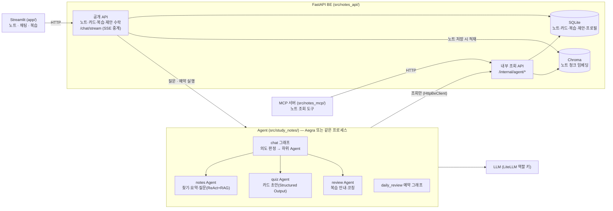

# 학습 노트 비서 작업 개요

## 목표

agent-template 위에 **독서·학습 노트 비서**(Agentic 서비스)를 완성한다. 사용자는 Streamlit 화면에서 노트를 쓰고, 채팅으로 노트 요약·찾기·질문(RAG), 퀴즈 카드 만들기, 복습 안내를 받는다. 구조는 Streamlit(FE) → FastAPI(BE) → Agent(Aegra 위 LangGraph 멀티 에이전트)이고, 부트캠프 과제의 필수 기술 요소(프롬프트 엔지니어링, LangGraph 멀티 에이전트·Tool Calling·ReAct·Memory, RAG·Vector DB, Streamlit·FastAPI 패키징)와 선택 요소(Structured Output·Function Calling, MCP)를 담는다.

## 계획 상태

- 작성일: 2026-11-23
- 기준 브랜치: `main`
- 선행 커밋: `5673e1f` (agent-template에서 생성)

## 확인된 문제

- 템플릿은 예시 Agent(`agents/tasks`)와 예시 예약 그래프(`graphs/daily_check.py`)만 있고, 업무 데이터는 가짜 BE(`tools/fakes/be.py`)의 할 일 3건뿐이다.
- 템플릿의 하위 Agent는 코드가 정한 순서로만 도구를 부른다. 모델이 도구를 고르는 경로(Function Calling·ReAct)가 없다. `LlmRequest`는 `system`+`user` 한 쌍만 받고 도구 정의·도구 호출 결과를 다루지 못한다 (`src/study_notes/llm/gateway.py`).
- RAG(전처리·임베딩·Vector DB)가 없다. 역할 키 `embedding`만 선언돼 있다.
- FE·BE가 없다. 템플릿은 "FE → BE → ai-agent" 구조를 전제한다 (`docs/01-구조.md` §1).
- 과제 요구사항(사용자 제공, 2026-11-23): 멀티 에이전트(단일 Agent 미인정), Tool Calling·ReAct·Memory, RAG(전처리·임베딩·FAISS/Chroma), Streamlit UI, FastAPI 백엔드, Docker(선택), Structured Output·Function Calling(선택 A), MCP(선택 B), A2A(선택 C).
- 개발 PC 환경 (2026-11-23 확인)
  - Python 3.13.7, SQLite 3.50.4
  - Docker 없음
  - PostgreSQL 17 서비스(`postgresql-x64-17`)가 설치돼 있지만 **멈춰 있음**, 5432 포트 응답 없음 → Aegra 실행에 필요
- `docs/unit-of-work-guide.md` §5("이 리포에서의 규칙")는 Gradle·H2·`atworks-schema.sql`을 말한다. 이 저장소(Python)와 맞지 않아 아래 "진행 규칙"에 Python 대응 규칙을 적었다.

## 전체 구조



## 설계 결정과 가정

| 결정 | 선택과 이유 | 비교한 대안 |
|---|---|---|
| BE | `src/notes_api/` FastAPI. 저장(SQLite)·숫자 계산(복습 간격·통계)·RAG 적재·Agent 호출 중계를 맡는다. 템플릿 구조(FE→BE→Agent)와 과제의 FastAPI 요구를 함께 만족 | 파이썬 모듈만(과제 요구 불충족), Agent 안에 저장 코드(절대 규칙 1 위반) |
| Agent → BE | 템플릿의 `HttpBeClient`가 BE 내부 조회 API(`/internal/agent/*`)를 부른다. 조회만 | Agent가 SQLite 직접 접근(BE 경계가 흐려짐) |
| 가짜 BE | `FakeBeClient`는 합성 데이터 리스트 + 단순 단어 겹침 검색. Agent 시험이 BE 패키지·Chroma 없이 빨리 돈다. 실제 연결은 계약 시험(HttpBeClient ↔ BE 앱, ASGI 전송)으로 확인 | FakeBeClient가 BE 앱을 품음(시험이 느리고 결합) |
| Vector DB | Chroma(`chromadb` PersistentClient, 시험은 EphemeralClient). 노트북별 메타데이터 필터가 쉽다. 설치가 안 되면 FAISS로 바꾸고 기록 | FAISS(메타데이터 필터를 따로 짜야 함) |
| 임베딩 | `Embedder` 약속. 실제는 LiteLLM 역할 키 `embedding`, 모델이 없으면 결정적 해시 임베딩(문자 n-gram)으로 대신. 청크마다 임베딩 이름·버전을 메타데이터에 남긴다 | sentence-transformers 로컬 모델(설치 무거움) |
| 전처리 | 노트 본문을 제목·문단 기준으로 나눈 뒤 길이 상한(약 400자, 겹침 50자)으로 자른다. 적재는 노트 저장 때 BE가 한다(대화 중 적재 금지, AGENTS §3.2) | 대화 중 즉석 적재 |
| 멀티 에이전트 | 템플릿 오케스트레이터(규칙 → 모델 분류, 최대 3의도) + 하위 Agent 3개(notes·quiz·review). 하위 Agent끼리는 부르지 않고 `ask` 버튼으로 잇는다 | langgraph-supervisor(AGENTS §9 금지) |
| Tool Calling·ReAct | 게이트웨이에 도구 정의·도구 호출·다중 메시지를 더하고, `BaseAgent.react()`가 생각→도구→관찰 루프를 돈다(최대 단계·도구 상한). 모델이 고를 수 있는 도구는 `llm_selectable=True`인 조회 도구뿐 | langgraph.prebuilt.create_react_agent(템플릿 도구 실행기·기록을 우회) |
| Structured Output | Pydantic 모델의 JSON 스키마로 출력 형식을 고정(`ask_llm_json`). 의도 분류·요약·퀴즈·질의응답 최종답 | 자유 문장 파싱 |
| 프롬프트 | 버전 파일. 역할 지시 + 근거 제한 + 단계별 사고(내부 `reasoning` 칸, 화면에 안 보임) + few-shot 예시 + 출력 스키마 | 코드 문자열(절대 규칙 7 위반) |
| 메모리 | 단기: Aegra 체크포인터(thread 대화) + `ChatState.focus_note_ids`(최근 다룬 노트, "그 노트로 퀴즈" 처리). 장기: BE의 학습자 프로필(선호 요약 길이·퀴즈 난이도, BE가 계산한 약한 노트) | LangGraph Store(Aegra 쪽 설정·운영 확인 필요) |
| subject_id | 노트북(공부 묶음) ID. 예: `NB-1`. 예약 그래프가 노트북 단위로 돈다 | 사용자 ID(1인용), 노트 ID(목록·검색 불가) |
| 화면 정보 | `context.screen`에 `note_id`(보고 있는 노트), `base_date`(기준일). 없으면 기준일은 오늘 | 질문 문장에서만 추출 |
| 복습 간격 | BE가 단순화한 SM-2로 계산 (again/hard/good/easy) | Agent가 계산(절대 규칙 4 위반) |
| 제안 처리 | `save_proposal` 버튼 → UI가 BE `POST /proposals/accept` → BE가 `dedupe_key`로 한 번만 저장하고 종류별 반영(카드 추가 등). 누름 = 사용자 승인 | 저장·반영 버튼 분리(토이에 과함) |
| Agent 실행 위치 | BE의 `AgentBridge` 약속. `inprocess`(BE 프로세스에서 그래프 실행, PostgreSQL 불필요) / `aegra`(langgraph-sdk). 설정 `NOTES_API_AGENT_MODE` | Aegra만(PostgreSQL 없으면 아무것도 못 봄) |
| UI 위치 | 화면은 `app/`, 시험할 로직(BE 클라이언트·SSE 읽기·버튼 처리)은 `src/notes_ui/` | 전부 Streamlit 파일 안(시험 불가) |
| MCP | `src/notes_mcp/`: 공식 `mcp` SDK(FastMCP)로 BE 조회 API를 MCP 도구로 노출(stdio). Claude Desktop 등 다른 에이전트가 노트를 쓰게 한다 | Agent가 MCP 클라이언트로 도구를 받음(이 서비스엔 외부 도구가 필요 없음) |
| A2A | 이번 범위 밖. Aegra 0.12의 A2A 지원 여부를 확인하지 않았다(질문 목록) | — |
| Docker | 선택. `Dockerfile`·`docker-compose.yml`을 쓰되 이 PC에 Docker가 없어 검증은 못 한다고 기록 | — |
| 모델 | 기본은 가짜 모델(모든 답이 규칙 답, 해시 임베딩). 실제 모델은 `.env`의 역할 키(`router`·`worker`·`judge`·`embedding`)로 켠다 | — |

가정 (확인할 것은 "질문 목록"에 모은다)

- 사용자는 1명. Aegra 인증은 `dev` 모드 헤더, BE 인증은 없음(로컬 전용).
- 합성 시드 노트는 직접 쓴 짧은 학습 메모다(책 본문 인용 없음).
- 실제 LLM·임베딩 공급자와 키는 아직 없다. 코드는 LiteLLM 역할 키로만 부르고, 모든 기능은 가짜 모델로도 돈다.

## Unit of Work 목록

- [x] Unit 01: 개발 환경과 기준선 — `units/unit-01-env-baseline.md`
- [x] Unit 02: BE 저장소(SQLite)와 복습 계산 — `units/unit-02-store.md`
- [x] Unit 03: RAG 적재·검색(전처리·임베딩·Chroma) — `units/unit-03-rag.md`
- [x] Unit 04: FastAPI BE(공개 API·내부 조회 API) — `units/unit-04-fastapi-be.md`
- [x] Unit 05: Agent의 BeClient를 학습 노트 업무로 — `units/unit-05-be-client.md`
- [x] Unit 06: Function Calling 게이트웨이와 ReAct 루프 — `units/unit-06-react.md`
- [x] Unit 07: notes Agent(찾기·요약·RAG 질의) + 대화 메모리 + 예시 제거 — `units/unit-07-notes-agent.md`
- [x] Unit 08: quiz Agent(Structured Output·few-shot·제안) — `units/unit-08-quiz-agent.md`
- [ ] Unit 09: review Agent + daily_review 예약 그래프 + 장기 메모리 — `units/unit-09-review-agent.md`
- [ ] Unit 10: BE ↔ Agent 연결(SSE 중계·예약 실행·제안 수락) — `units/unit-10-agent-bridge.md`
- [ ] Unit 11: Streamlit UI — `units/unit-11-streamlit.md`
- [ ] Unit 12: Aegra 실행 연동 — `units/unit-12-aegra.md`
- [ ] Unit 13: MCP 서버(선택 B) — `units/unit-13-mcp.md`
- [ ] Unit 14: 평가 확장·문서·패키징 마무리 — `units/unit-14-finish.md`

## 의존관계

```text
01 → 02 → 03 → 04 ─┐
01 → 05 → 06 → 07 → 08 → 09 ─┴→ 10 → 11 → 12 → 13 → 14
```

- BE 줄기(02~04)와 Agent 줄기(05~09)는 파일이 겹치지 않아 병렬 가능하다. 다만 05의 계약 시험은 04의 내부 API가 있어야 하므로, 이 계획에서는 **02 → 03 → 04 → 05 → … 순서대로** 한다.
- 08·09는 `agents/registry.py`, `eval/cases/`, `tests/`를 함께 고치므로 순서대로 한다.
- 12의 Aegra 실행은 PostgreSQL이 떠 있어야 한다. 막히면 코드·시험까지만 하고 차단 사유를 적는다.

## 진행 규칙

`docs/unit-of-work-guide.md` §4를 따른다. §5 대신 이 저장소에서는 아래를 따른다.

- 한글 Markdown 편집 전 콘솔을 UTF-8로 맞춘다(파일은 UTF-8, BOM 없음).
- 검사 명령(가상환경 `.venv`, 저장소 루트에서):
  - 시험 `.\.venv\Scripts\python.exe -m pytest -q`
  - 린트 `.\.venv\Scripts\python.exe -m ruff check src tests tools migrations app`
  - 형식 `.\.venv\Scripts\python.exe -m ruff format --check src tests tools migrations app`
  - 타입 `.\.venv\Scripts\python.exe -m mypy`
  - 평가 `.\.venv\Scripts\python.exe -m study_notes.eval`
- Unit에서는 관련 시험을, 마지막 Unit에서는 다섯 검사 전부를 돌린다. 실패가 환경 문제인지 코드 문제인지 구분해 적는다.
- 시험은 개발 데이터(`data/`)·PostgreSQL이 아니라 메모리 SQLite·메모리 Chroma·가짜 모델을 쓴다.
- 약속(`BeClient`, BE API, 이벤트 형식, 버튼, 설정 키)이 바뀌면 `README.md`·`docs/01-구조.md`·`docs/02-개발-가이드.md`를 함께 고친다(최종 정리는 Unit 14).
- `AGENTS.md` 절대 규칙을 지킨다. 특히 Agent 패키지(`src/study_notes`)는 `notes_api`를 import하지 않는다(예외: 없음). BE가 Agent를 부르는 쪽이다.
- Unit이 끝나면 커밋한다. 메시지 형식 `feat(unit-NN): ...`.

## 상태 기록

| Unit | 상태 | 검증 결과 |
|---|---|---|
| 01 | 완료 | pytest 31 passed, ruff·format·mypy(56 files) 통과, eval 2/2. chromadb 1.5.9·streamlit 1.67.0·mcp 설치 |
| 02 | 완료 | tests/api 16 passed(srs 10·store 6), 전체 47 passed, ruff·format·mypy 통과 |
| 03 | 완료 | tests/api/test_rag.py 7 passed(체크포인터·ReAct·이벤트 루프 질의 1위), ruff·format·mypy 통과. Chroma 1.5.9 그대로 사용 |
| 04 | 완료 | tests/api 31 passed(API 8), 전체 62 passed, ruff·format·mypy 통과. uvicorn 실행 /health notes 5·chunks 10, 검색 200 확인 |
| 05 | 완료 | 전체 67 passed(가짜 BE 3·계약 2 포함), ruff·format·mypy 통과, eval 2/2. 예시 데이터 subject를 DEMO-001→NB-1로 옮김(Unit 07에서 삭제) |
| 06 | 완료 | tests/unit/test_react.py 5 passed(도구→답, 숨은 도구 차단, 입력 오류 회복, 단계 상한, LiteLLM 변환), 전체 72 passed, ruff·format·mypy 통과 |
| 07 | 완료 | 전체 85 passed(notes 그래프 12·규칙 18), ruff·format·mypy 통과, eval 7/7. 예시 tasks·daily_check·TaskItem 제거, 오케스트레이터 프롬프트 v2(few-shot) |
| 08 | 진행 중 |  |
| 09 | 대기 | |
| 10 | 대기 | |
| 11 | 대기 | |
| 12 | 대기 | |
| 13 | 대기 | |
| 14 | 대기 | |

## 전체 완료 기준

- BE(`uvicorn notes_api.main:app`)와 UI(`streamlit run app/streamlit_app.py`)를 띄우면, 노트를 쓰고(저장 시 RAG 적재), 채팅으로 찾기·요약·노트 기반 질문·퀴즈·복습 질문을 하고, [카드 저장] 버튼으로 카드가 생기고, 복습 화면에서 카드를 넘기면 다음 복습일이 바뀐다.
- 모델 없이(가짜 모델·해시 임베딩) 모든 기능이 규칙 답으로 돈다. 모델을 켜면 같은 경로가 Function Calling·ReAct·Structured Output으로 돈다(가짜 모델 시나리오 시험으로 확인).
- PostgreSQL이 떠 있으면 `aegra serve` + `NOTES_API_AGENT_MODE=aegra`로 같은 화면이 Aegra를 거쳐 돈다.
- MCP 서버가 노트 검색·조회 도구를 내놓는다(시험으로 확인).
- 다섯 검사(시험·린트·형식·타입·평가)가 모두 통과한다.

## 과제 요구사항 대응표

| 과제 요소 | 어디서 | Unit |
|---|---|---|
| 역할 기반 프롬프트·CoT·Few-shot·구조화 | `agents/*/prompts/*.v<n>.md`, `orchestrator/prompts/` | 07·08·09 |
| Multi-Agent | chat 그래프 오케스트레이터 + notes·quiz·review | 07~09 |
| Tool Calling·ReAct | 게이트웨이 도구 호출 + `BaseAgent.react()` (notes 질의) | 06·07 |
| Memory | 체크포인터 + `focus_note_ids`(단기), 학습자 프로필(장기) | 07·09 |
| RAG(전처리·임베딩·Vector DB) | `notes_api/rag/` (청크·Embedder·Chroma) + `notes_search_chunks` 도구 | 03·07 |
| Streamlit UI | `app/` | 11 |
| FastAPI BE | `notes_api/` | 04·10 |
| Docker(선택) | `Dockerfile`, `docker-compose.yml` (미검증) | 14 |
| Structured Output·Function Calling(선택 A) | `ask_llm_json`, 게이트웨이 tools | 06~09 |
| MCP(선택 B) | `notes_mcp/` | 13 |
| A2A(선택 C) | 범위 밖 | — |

## 질문 목록 (작업 뒤 사용자에게 확인)

진행 중 생긴 질문을 여기에 모은다. 답이 올 때까지는 위 "가정"대로 진행한다.

1. 실제 LLM·임베딩 공급자와 모델(OpenAI, Bedrock 등)과 키 — `.env`의 `STUDY_NOTES_LLM__MODELS`에 넣을 값.
2. 로컬 PostgreSQL 17 서비스를 켜고 접속 정보(`.env`의 `POSTGRES_*`)를 채워도 되는지 — Aegra 실행에 필요.
3. A2A(선택 C)를 넣을지 — 넣는다면 Aegra의 A2A 지원 여부부터 확인해야 한다.
